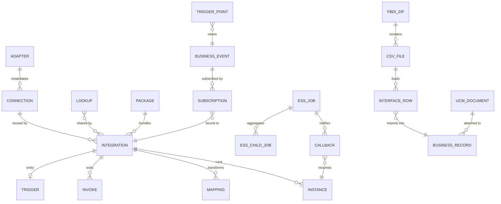

# Oracle Fusion 系统间集成模块研究（2026-11-15）

> 目的：为平台级「系统间集成」能力提供 Fusion 侧事实依据：核心对象是什么、对象之间怎么连、对外服务能力边界在哪、规则放在哪一层。
> 范围：Oracle Fusion Cloud ERP/SCM（26B/26C/26D）+ Oracle Integration Cloud（OIC，Gen 3）；横向对标 SAP / Salesforce / Dataverse / Workday / NetSuite（§6，2026-11-15 定向取证官方文档）。
> 证据等级：`P0` = docs.oracle.com 官方文档；`P1` = Oracle 官方但非集成专题页；`B` = 第三方整理（仅作概念补位，不作设计依据）。
> 我方对照基线：`ARCHITECTURE_V3.md` v3.10 + 2026-11-13/14 的 message-platform / unified-async-job / platform-attachment / import-export 四份 spec。

---

## 0. 结论先行

1. **Fusion 的「集成」不是一个模块，而是一组按方向/时序切开的通道**。官方在 SCM 侧明确列出 **9 种标准集成选项**，彼此不替代：FBDI（批入站）、Data Extraction（批出站）、REST、SOAP、Public Business Events via OIC（事件）、Collaboration Messaging（B2B）、FSM（配置迁移）、Redwood Extension（UI）、BICC（数据湖）。选型靠「方向 × 实时性 × 数据量 × 是否有事件语义」四问，而不是靠一个万能 API。[cite:1]

2. **事件链的真正对象在 Fusion 侧，编排对象在 OIC 侧**。Fusion 提供 `Business Event` + `Event Subscription` + `Business Event Trigger Point`；OIC 提供 `Connection` / `Integration` / `Lookup` / `Package` / `Instance`。把 OIC 当成「Fusion 的一个功能」是常见误判——它是独立的一等平台。[cite:2]

3. **批量链是「文件 + 接口表」两段式，不是一次 API 调用**。FBDI 固定 5 步：模板 → CSV → ZIP → UCM → Load Interface File for Import（接口表 → 业务表）。这一层 `Interface Table` 是 Fusion 批量集成最核心、也最容易被自研系统忽略的对象。[cite:4]

4. **所有长耗时动作最终都收敛到两个对象：ESS Job 和 UCM Document**。ERP Integration Service 20 个操作里，5 个管 ESS、6 个管 UCM、6 个管批量、3 个管元数据；`importBulkData` 之所以「一个操作搞定入站」，是因为它在内部串起了 UCM + ESS + Callback 三件事。[cite:5]

5. **可靠性靠「回调 + 手动 resubmit」而不是自动重试**。OIC 不做自动重投；失败实例需要人工 resubmit，单实例上限 **10 次**，同步流不可 resubmit，带定时参数的 scheduled 流也不可。[cite:6] 这与「企业级集成必须自动重试」的直觉相反，是 Fusion 的明确设计取舍。

6. **规则的承载位置被严格分层**：`触发规则`在 Fusion（Trigger Points）、`订阅规则`在 Fusion Event Catalog + 订阅记录、`路由/编排规则`在 OIC、`映射规则`在 OIC Mapper + Lookup、`安全规则`在 Connection 的 security policy、`回写校验规则`在 Fusion 的服务契约（如 `ChangeOrderAllowed`）。**跨层复制规则是集成系统最常见的架构腐化源。**

7. **Echo suppression 是双向同步的必备开关，且属于连接级配置**，不是业务代码里的 if。这说明 Fusion 把「防回声」视为集成基础设施职责，而非某个接口的特殊处理。[cite:2]

8. **Fusion 不开放 SQL 直查**，出站取数必须走 BIP report + Adapter 调用。这直接否定了「用只读库直连做集成」的路线。[cite:2]

9. **与我方现状的最大差距不是通道，而是「对象层级缺失」**：我方事件侧是 `change_events` + `change_subscriptions`（`webhook_url`/`webhook_secret` 内联）+ `notification_deliveries`（投递事实：事件×订阅×通道一行，`UNIQUE(event_id, subscription_id, channel)`，attempts<5 + 1m/5m/15m/1h 退避）+ `ChangeEventWorker`，**Event / Subscription / Instance 三层已成立**；缺的是 `Connection`（连接复用与密钥管理，现被压进订阅行的两个字段）与 `Integration`（编排/扇出）。[cite:9]

10. **我方异步作业（`job_definitions` / `job_triggers` / `task_runs`）在结构上已对齐 ESS**，但缺 Fusion 的两个关键物：`Interface Table`（staging + 校验 + 错误行）与 `Callback`（ERP 主动回推，我方是轮询）。[cite:10][cite:12]

11. **横向看六家产品，集成骨架收敛为「六个核心槽位 + 一个交付槽位」**：连接 / 编排 / 事件 / 映射 / 投递实例 / 批量 staging，外加交付打包（Package / Transport / Solution / SuiteBundle）。「投递实例」6/6 独立成对象，「连接与编排分离」5/6——我方已有事件 / 订阅 / 投递三层，缺的是「连接」与「编排」两层——不是「少几个功能」，而是槽位没补齐。[cite:13][cite:16][cite:20][cite:21]
12. **没有任何一家承诺 exactly-once 或无限重试**：六家全部是「至少一次 + 幂等键 + 有边界的重试（人工 / 有限次 / DLQ）」。我方已是 attempts<5 + 指数退避 + `(event_id, subscription_id, channel)` 唯一键幂等 + 手动 retry 归属校验/防抖，**与基线一致**；待补的只是连接级密钥体系。[cite:18][cite:19]

13. **平台化的正确姿势是「事实归表、配置归模块」**：我方已有 4 张事实表（`change_events` / `notification_deliveries` / `task_runs` / `doc_flow_edges`）各管一件事，本次只需新建 2 个配置/暂存对象（`integration_connection` / `import_staging_rows`），并给 `doc_flow` 的映射链补「条件 / 表达式 / Lookup」三个钩子。新模块全部为平台级通用模块（只认标识与契约，不认单据语义）；`doc_flow` 因同事务前提留在业务域，不上升为平台模块。

---

## 1. 集成选项全景：9 条通道，各有归属

### 1.1 官方 9 选项

| # | 选项 | 方向 | 时序 | 核心对象 | 典型场景 | 硬约束 |
|---|---|---|---|---|---|---|
| 1 | **FBDI**（File-Based Data Import） | 入站 | 批 | 模板 / ZIP / UCM / 接口表 / ESS | 主数据与大批量单据导入 | 非实时；≤10 万行/批；并发 ≤5；ZIP ≤250MB；单文件 ≤1GB；UTF-8 [cite:4] |
| 2 | **Data Extraction Tool** | 出站 | 批 | 提取定义 / 输出文件 | 定期全量/增量导出 | 面向文件，不保证实时 |
| 3 | **REST API** | 双向 | 实时 | REST 资源 / 业务对象 | 单记录 CRUD、按需查询 | 逐条；大批量性能差 |
| 4 | **SOAP Service** | 双向 | 实时 | WSDL / 服务操作 | 需要强类型契约、附件（MTOM） | 契约重；不支持 SQL 直查 |
| 5 | **Public Business Events via OIC** | 出站 | 近实时 | Business Event / Subscription / OIC | 状态变化通知下游、双写同步 | 私网 endpoint **不支持** business events [cite:2] |
| 6 | **Collaboration Messaging** | 双向 | 准实时 | 伙伴 / 消息类型 / B2B 文档 | EDI、供应商协同 | 面向 B2B 报文，非通用 API |
| 7 | **Functional Setup Manager** | 双向 | 批 | Setup Task / 配置包 | 配置在环境间迁移 | 只搬配置，不搬业务数据 |
| 8 | **Redwood Application Extension** | — | — | 扩展点 / 页面 | UI 层扩展 | 不是数据集成通道 |
| 9 | **BI Cloud Connector (BICC)** | 出站 | 批 | 数据存储 / 抽取 | 数据湖、数仓供数 | 面向分析，不面向事务回写 |

> 选型判据（本报告归纳）：**入站大批量 → 1；出站大批量 → 2/9；事务回写 → 3/4；状态广播 → 5；贸易伙伴 → 6；环境迁移 → 7。**

### 1.2 通道之间的关系

不是「择一」，而是**一套系统里同时存在多条**：订单状态用 5 广播、主数据用 1 导入、发票回写用 3、月末对账用 2/9。这决定了集成对象模型必须支持「多通道并存 + 统一可观测」，而不是围绕单一 API 建模型。

### 1.3 FBDI 五步：官方流程与硬门槛

| 步骤 | 动作 | 产出 / 门槛 | 失败在哪暴露 |
|---|---|---|---|
| 1. 下载模板 | 按业务对象取官方 Excel 模板 | 列序与工作表名不可改 | — |
| 2. 准备数据 | 填模板（业务规则校验此时**不**执行） | 数据行 | 导入期 |
| 3. 生成 CSV / ZIP | 宏或工具生成 CSV 并打 ZIP | ZIP ≤250MB、单文件 ≤1GB、UTF-8、DEFLATE | 上传前 |
| 4. 上传 UCM | `uploadFileToUcm`，或由 `importBulkData` 内部完成 | `documentId` | 上传期 |
| 5. Load Interface File for Import | 接口表落行 → ESS 作业导业务表 | 接口表行状态 + 错误信息 | **接口表（行级）** |

> 关键点：**前 4 步全是「准备」，真正的业务校验只发生在第 5 步的接口表**。把 staging 当成「可选优化」就会踩这个坑——错误只在接口表里可见，没有 staging 就没有行级错误报告，也没有「部分成功」的语义。[cite:4]

---

## 2. 核心对象模型

### 2.1 OIC 侧（编排平台）

| 对象 | 语义 | 关键属性 | 生命周期 | 证据 |
|---|---|---|---|---|
| **Connection** | 到一个 endpoint 的连接配置 | endpoint URL / security policy / agent group / 凭据引用 | 创建 → 测试 → 被集成引用 → 停用 | P0 [cite:2] |
| **Adapter / Connection Factory** | 协议适配器类型 | REST / SOAP / ERP Cloud / FTP / File / DB / JMS 等 | 平台内置 | P0 [cite:2] |
| **Integration** | 编排单元（一次集成的定义） | style / trigger / invoke / mapping / 版本 | 草稿 → 激活 → 版本迭代 → 停用 | P0 [cite:2] |
| **Trigger** | 集成入口 | 事件 / REST / SOAP / 定时 / 文件 | 随集成 | P0 |
| **Invoke** | 集成出口（可多个） | connection 引用 + 操作 | 随集成 | P0 |
| **Mapping** | 源结构 → 目标结构 | 字段映射 / 表达式 / Lookup 引用 | 随集成 | P0 [cite:2] |
| **Lookup** | 跨集成复用的键值映射表 | 列定义 + 行数据（code → value） | 独立维护，被 N 个集成引用 | B [cite:7] |
| **Package** | 集成的打包与版本化交付 | 包含的 integration / connection / lookup | 导出 → 导入到另一环境 | B [cite:7] |
| **Agent Group** | Connectivity Agent 分组（打通私网） | agent 成员 / 网络可达性 | 注册 → 心跳 → 掉线告警 | P0 [cite:2] |
| **Instance / Message** | 一次运行的实例与消息体 | 状态 / trace / payload / 错误 | 运行 → 成功/失败 → 归档 | P0 [cite:6] |
| **Error / Resubmit** | 实例级错误处理 | 可恢复性 / resubmit 次数 / tracing level | 失败 → 人工 resubmit（≤10 次） | P0 [cite:6] |

> 属性细化（可直接建枚举）：**Connection 的 security policy 共 5 种**——`Username Password Token`、`Username Password Token With PGP Key Support`、`OAuth Authorization Code Credentials`、`OAuth JWT User Assertion`（用密钥对替代 client secret）、`Token-based`（business/FBDI event 消息专用，自签 session token）。[cite:2] **Integration 的 style 共 3 种**——Application（App Driven Orchestration）、Scheduled、Event（OIC 内部 pub/sub）；早期的 Basic Routing / File Transfer / Publish-Subscribe 属历史形态。[cite:7]

> 说明：Lookup / Package / Agent Group 的**字段级**结构未在本次调研中取证到官方逐字段页，仅按 OIC 设计器概念登记，标注为 B 级；ERP Adapter 侧的「agent group 用于私网访问」有官方依据。[cite:2]

### 2.2 Fusion 侧（业务与运行时）

| 对象 | 语义 | 关键属性 | 证据 |
|---|---|---|---|
| **Business Event** | 业务对象状态变化对外发布的事件 | 事件名 / 负载（含对象标识与变更内容） | P0 [cite:2][cite:3] |
| **Event Subscription** | 某订阅方对某事件的订阅登记 | 事件名 / 回调 endpoint / 状态 | P0 [cite:2] |
| **Business Event Trigger Point** | 哪些业务动作触发事件 | 模块 / 对象 / 动作（状态变更、拆分、关闭、挂起…） | P0 [cite:3] |
| **ESS Job** | 企业调度作业 | `jobPackageName` + `jobDefinitionName` + `paramList` → `requestId` | P0 [cite:5] |
| **ESS Child Job** | 父作业下的子作业 | 父 requestId 下的多条子状态 | P0 [cite:2] |
| **UCM Document** | WebCenter Content 中的文档 | `documentId` / 账户 / 文件名 / 备注 | P0 [cite:5] |
| **Interface Table** | FBDI 落地的中间表 | 批次 / 行状态 / 错误信息 | P0 [cite:4] |
| **REST Resource / SOAP Service** | 对外服务契约 | 资源路径 / WSDL / 操作 | P0 [cite:5] |
| **Callback Endpoint** | ERP 向 OIC 回推作业结果 | URL / 结果负载（整体状态 + Document ID + 子作业状态） | P0 [cite:2] |
| **BIP Report** | 出站取数的唯一受支持数据源 | 报表定义 / 参数 / 输出 | P0 [cite:2] |

> 关键点：`Business Event` 与 `ESS Job` 是**两个不同世界**——事件是「发生了什么」，作业是「跑了什么」。把它们混成一个「消息表」是我方当前设计的失真点之一。

### 2.3 两侧对象的分工线

| 关注点 | Fusion 侧 | OIC 侧 |
|---|---|---|
| 什么时候产生消息 | Trigger Point / ESS 提交 | Trigger |
| 消息长什么样 | 事件负载 / 服务契约 | Mapping 后的结构 |
| 消息去哪 | 不关心（只登记 Subscription 或回调 URL） | Invoke（N 个出口） |
| 出错怎么办 | 作业失败 → 回调里带状态 | Instance 级 resubmit |
| 谁管凭据 | 服务端授权（角色/职责） | Connection 的 security policy |

这条分工线是整份报告的结构主轴：**Fusion 只负责「产生」与「接收」，OIC 负责「编排」与「投递」**。

---

## 3. 对象关系模型

### 3.1 基数表

| 关系 | 基数 | 约束/说明 |
|---|---|---|
| Connection ↔ Integration | **N : N** | 一个连接被多个集成复用；一个集成可调多个连接 |
| Adapter → Connection | 1 : N | 一个适配器类型下多个连接实例 |
| Integration → Trigger | 1 : 1 | 每个集成一个入口 |
| Integration → Invoke | 1 : N | 多出口（广播/扇出） |
| Integration → Mapping | 1 : N | 每对 source/target 一份映射 |
| Integration → Instance | 1 : N | 每次运行一条实例 |
| Business Event → Subscription | **1 : N** | 一个事件被多个订阅方订阅 [cite:3] |
| Subscription → Integration | N : 1 | 订阅最终绑定到某个 OIC 集成（或 connector） |
| Business Event → Trigger Point | **N : 1** | 多个触发动作汇入同一事件名 |
| ESS Job → ESS Child Job | 1 : N | 父作业聚合子作业状态 [cite:2] |
| ESS Job → Callback | 1 : N | 一次提交一次回调（可重入） |
| FBDI ZIP → CSV | 1 : N | 一个 ZIP 内多模板文件 [cite:4] |
| CSV → Interface Table Row | 1 : N | 逐行落地 |
| Interface Table Row → Business Record | N : 1 | 导入后写入业务表 [cite:4] |
| UCM Document → 业务记录 | N : N（多态） | 附件通过实体注册挂到任意对象 |
| Lookup ↔ Integration | N : N | 映射表被多处复用 |

### 3.2 对象关系图



### 3.3 三条端到端链路

**A. 事件链（Fusion → OIC → N 个订阅方）**

```
业务动作（状态变更/拆分/关闭/挂起）
   → Trigger Point 判定是否发事件
   → Business Event（登记在 PublicEvent catalog）
   → 订阅记录（POST /soa-infra/PublicEvent/subscriptions）
   → OIC Integration（Trigger = ERP Adapter 事件订阅）
   → 编排（enrichment + mapping + switch）
   → N 个 Invoke（下游系统）
   → [可选] 回写 Fusion：OrderInformationService / OrderFulfillmentResponseService
```

要点：**扇出发生在 OIC，不在 Fusion**。Fusion 只管「发一次」，谁订阅谁负责。回写也是走服务，而不是「反向事件」。[cite:3]

**B. 入站批量链（FBDI / importBulkData）**

```
Excel 模板 → 宏生成 CSV → 打 ZIP
   → 上传 UCM（uploadFileToUcm 或 importBulkData 内部完成）
   → Load Interface File for Import（接口表）
   → ESS import 作业（接口表 → 业务表）
   → Callback（整体状态 + Document ID + 所有作业/子作业状态）
   → OIC 判定成功/失败 → 失败则取日志、修数据、重投
```

要点：`importBulkData` 是「一站式」封装；老写法 `loadAndImportData` 仍存在但已非主推。回调替代了旧的「Integration Flow Identifier + Version」机制（`ErpImportBulkDataEvent`）。[cite:5][cite:2]

**C. 出站批量链（exportBulkData / BIP）**

```
BIP 报表 或 exportBulkData 发起提取
   → 输出写入 UCM（documentId）
   → 下载（MTOM 优先，失败回退 BASE64）
   → 下游消费
   → confirmExtractConsumption（确认消费，删源端）
   → extractAndPurge（清理提取残留）
```

要点：出站不是「推」，是「生成文档 + 通知 + 拉取 + 确认」。**没有 confirmExtractConsumption 就没有真正的「已消费」语义**——这是很多自研系统丢的一环。[cite:5]

---

## 4. 服务能力矩阵

### 4.1 按能力维度

| 能力 | Fusion/OIC 的事实 | 边界/限制 | 证据 |
|---|---|---|---|
| **同步请求-响应** | REST / SOAP 直调，返回即时结果 | 大批量不可用；长事务易超时 | P0 [cite:5] |
| **异步回调** | ESS `submitJobWithOutput` + callbackURL；批量导入回调 | 回调需 OIC 侧可达 endpoint | P0 [cite:2][cite:5] |
| **纯异步（无回调）** | 事件发布（fire-and-forget） | 发布方不感知下游成败 | P0 [cite:3] |
| **批处理** | FBDI 入站、exportBulkData 出站、BICC | ≤10 万行/批、并发 ≤5、ZIP ≤250MB | P0 [cite:4] |
| **实时性分档** | 实时（REST/SOAP）、近实时（事件）、批（FBDI/ESS） | 事件无 SLA 承诺；FBDI 非实时 | P0 [cite:1][cite:4] |
| **幂等** | 服务层由业务键与接口表主键保证 | 事件不保证「恰好一次」 | P0 [cite:4] |
| **重试** | **仅手动 resubmit**，单实例 ≤10 次 | 同步流不可 resubmit；带定时参数的 scheduled 流不可 | P0 [cite:6] |
| **回放/重放** | 无原生 replay（对比 Salesforce ReplayId 的 72h 窗口） | 只能靠 resubmit 重跑实例 | P0 [cite:6][cite:16] |
| **错误可见性** | Observability → Errors / Instances；tracing 三档（production/audit/debug） | 调试档需重跑才生效 | P0 [cite:6] |
| **限速/配额** | FBDI 并发与行数上限；OIC 无统一 token bucket | 需在订阅方/编排侧自建限速 | P0 [cite:4] |
| **大文件/附件** | MTOM（25.02+，默认）失败回退 BASE64；UCM 存储 | 私网 endpoint 不支持事件 | P0 [cite:2] |
| **取数** | 必须 BIP report；**不支持 SQL 直查** | 无只读库直连路线 | P0 [cite:2] |
| **安全** | 4 种 connection policy + Token-based + JWT assertion + PGP | 两两组合有适用面差异 | P0 [cite:2] |

### 4.2 按通道 × 能力交叉

| 通道 | 同步 | 异步回调 | 批 | 事件语义 | 可 resubmit |
|---|---|---|---|---|---|
| REST | ✅ | ❌ | ❌ | ❌ | ❌（同步） |
| SOAP | ✅ | 部分（长作业另走 ESS） | ❌ | ❌ | ❌（同步） |
| FBDI / importBulkData | ❌ | ✅ | ✅ | ❌ | ✅（新实例） |
| exportBulkData | ❌ | ✅ | ✅ | ❌ | ✅（新实例） |
| Business Event | ❌ | ❌（发布即完） | ❌ | ✅ | ✅（下游实例） |
| ESS 直调 | ❌ | ✅ | ✅ | ❌ | ✅（新实例） |

### 4.3 一句话读法

**「实时」与「批量」在 Fusion 里是两套完全不同的对象与失败模型**：实时失败 = 调用方拿到错误码自己处理；批量失败 = 回调带状态 + 接口表留错误行 + 人工 resubmit。用同一套「重试中间件」去覆盖两者，必然失真。

### 4.4 ERP Integration Service 20 操作全清单

WSDL：`/fscmService/ErpIntegrationService?WSDL`。[cite:5]

| 组 | 操作 | 语义 |
|---|---|---|
| **ESS（5）** | `getESSJobStatus` / `submitESSJobRequest` / `submitJobWithOutput` / `getESSExecutionDetails` / `downloadESSJobExecutionDetails` | 提交、查状态、取执行明细、下载明细；`submitJobWithOutput` 多一个 `callbackURL` |
| **UCM（6）** | `uploadFileToUcm` / `getDocumentIdsForFilePrefix` / `getDocumentForDocumentId` / `getDocumentsForFilePrefix` / `appendFileComment` / `downloadExportOutput` | 上传、按前缀找文档、取元数据、追加备注、下载导出结果 |
| **集成作业（6）** | `loadAndImportData`（传统入站）/ `importBulkData`（主力入站）/ `exportBulkData` / `extractAndPurge` / `confirmExtractConsumption` / `updateInterfaceData` | 入站一站式、出站一站式、清理、消费确认、改接口表数据 |
| **元数据（3）** | `getDfltObjAttrHints` / `getServiceLastUpdateTime` / `getEntityList` | 对象属性提示、服务最后更新时间、实体清单 |

> 读法：**20 个操作不是 20 个业务能力，而是 5 类原子动作的叉乘**——提交、查询、取文件、改接口表、确认消费。任何平台要对接 Fusion，最少要实现「提交 + 查询 + 取文件 + 确认」四个动作，才能在失败时可恢复。[cite:5]

---

## 5. 规则模型

### 5.1 规则分层（最重要的结论）

| 规则类型 | 承载位置 | 具体机制 | 证据 |
|---|---|---|---|
| **触发规则** | Fusion | Manage Business Event Trigger Points（哪些动作发事件） | P0 [cite:3] |
| **订阅规则** | Fusion + OIC | Event Catalog + Subscription（POST subscriptions） | P0 [cite:2] |
| **路由规则** | OIC | Integration style（Application / Scheduled / Event）+ Invoke 选择 | P0 [cite:2] |
| **过滤规则** | OIC | Switch / 表达式 / 事件属性判定 | P0 [cite:2] |
| **转换/映射规则** | OIC | Mapper（BO/Event/REST 自动映射）+ Lookup | P0 [cite:2] |
| **安全规则** | OIC Connection | 4 种 security policy + Token-based + JWT assertion | P0 [cite:2] |
| **幂等/回声规则** | OIC Connection | Echo suppression 开关 | P0 [cite:2] |
| **配额/限速规则** | Fusion（批）+ 各方 | FBDI 并发/行数/体积上限 | P0 [cite:4] |
| **回写校验规则** | Fusion 服务契约 | `ChangeOrderAllowed` / `GetCrossReferencedData` / `processAcknowledgement` | P0 [cite:3] |

**反模式**：把「过滤」写进 Fusion 触发点、把「路由」写进业务代码、把「映射」写死在下游。Fusion 的答案是每类规则只有一个合法住所。

### 5.2 七类规则的落地矩阵

| 规则 | 允许配置面 | 禁止做法 | 后果 |
|---|---|---|---|
| 触发 | Trigger Point（配置驱动） | 在业务代码里 if 判断是否发事件 | 事件目录失真、订阅方拿不到 |
| 过滤 | OIC Switch / 订阅方 | 让所有下游自己判 | 网络与处理浪费 |
| 路由 | Invoke 列表 | 一个集成里硬编码目标系统 | 加一个下游要改代码 |
| 映射 | Mapper + Lookup | 逐字段手写转换类 | 版本升级即断裂 |
| 安全 | Connection policy | 把凭据写进集成 / 明文本地存 | 轮换成本高、泄露面大 |
| 回声 | Echo suppression | 业务侧靠「最后更新时间」猜 | 双向同步死循环 |
| 回写 | 服务契约校验（先问 allowed） | 直接改对方状态 | 越权、状态机被打穿 |

### 5.3 事件规则的具体形态（OM 例）

`Sales Order Notification` 的触发点官方列举：

- 抬头/行状态更新
- 行拆分、行关闭
- 应用挂起、变更 jeopardy 优先级
- 预定义属性更新
- 履约计划变更完成

配置入口 = Setup and Maintenance → **Manage Business Event Trigger Points**；订阅入口 = 订阅 OIC 集成（替代方案：Manage Connector Details 直连）。[cite:3]

回写侧规则由服务方法名直接表达：

| 服务 | 方法 | 规则含义 |
|---|---|---|
| OrderInformationService | `ChangeOrderAllowed` | 变更前必须先问「允许吗」 |
| OrderInformationService | `ChangeOrderAttributeAllowed` | 属性级可变更判定 |
| OrderInformationService | `GetCrossReferencedData` | 跨引用数据获取 |
| OrderFulfillmentResponseService | `processAcknowledgement` | 确认收到履约请求 |
| OrderFulfillmentResponseService | `processFulfillmentResponse` | 履约结果回写 |

这是**「先问后改」的规则模型**：变更合法性由被改方裁决，不由集成方假设。[cite:3]

---

## 6. 横向对标：另外五家头部产品的集成架构

> 本节资料来自 2026-11-15 对 SAP / Salesforce / Microsoft Dataverse / Workday / NetSuite 官方文档的定向取证（来源见 §10 的 13–21 号）。只采信官方文档；未取证的条目显式标注。

### 6.1 统一对象模型：六个核心槽位 + 交付槽位

把六家产品的集成能力折算到同一套「槽位」上，会看到非常稳定的骨架——**产品命名各异，槽位几乎一一对应**：

| 槽位 | Fusion / OIC | SAP S/4HANA | Salesforce | Dataverse / D365 | Workday | NetSuite |
|---|---|---|---|---|---|---|
| **连接**（endpoint + 凭据） | Connection（security policy） | Partner Profile + Port + Logical System | Named / External Credential | Service Endpoint | Integration System（ISU 运行身份） | Integration Record（key/secret/token） |
| **编排**（定义 + 版本） | Integration（style/trigger/invoke） | Integration Flow（CPI） | 无原生，交 MuleSoft | 无原生，交 Power Automate | Studio / Orchestrate | 无，逻辑在 SuiteScript |
| **事件**（发生了什么） | Business Event + Subscription | Business Event + Event Mesh topic | Platform Event / CDC | Business Event | Business Process 事件 | User Event Script 钩子 |
| **映射**（结构转换） | Mapping + Lookup | Message Mapping + Value Mapping | External Services（OpenAPI） | Dual-write 表映射 | Document Transformation（XSLT） | 脚本内手写 |
| **投递实例**（一次运行的事实） | Instance / Error | Message Processing Log | OutboundMessage 记录 | System Job（异步） | Integration Event | 异步 jobId |
| **批量 + staging** | FBDI → Interface Table | IDoc + SLT/DRF | Bulk API（无 staging） | DIXF 暂存表 | EIB 模板 + 暂存表 | Map-Reduce（无 staging） |
| **交付/打包** | Package | Transport（CTS+） | Unlocked / 2GP Package | Solution | 模板 + Studio 资产 | SuiteBundle / SDF |

三条读法：

1. **「投递实例」6/6 全部独立成对象**，没有一家把投递结果塞回事件定义里。这是全行业最硬的共识。
2. **「连接」与「编排」分离 5/6**，唯一例外是 NetSuite（逻辑内嵌在应用脚本里，没有独立编排层）。
3. **「批量 + staging」4/6 有暂存层**（Fusion / SAP / Dataverse / Workday）；Salesforce 与 NetSuite 走「直接 API + 客户端批」路线。

### 6.2 五种架构范式

| 范式 | 代表 | 一等公民 | 优势 | 代价 |
|---|---|---|---|---|
| **A 总线型** | SAP PI/PO + IDoc + Partner Profile | 报文契约（IDoc type / message type） | 强契约、可版本化、跨系统治理成熟 | 改动成本高；总线成为单点与瓶颈 |
| **B 平台编排型** | Fusion + OIC、SAP Integration Suite、Workday Studio+Connectors、MuleSoft | Integration（独立部署单元） | 连接/编排/可观测三分离；一个集成多方复用 | 需独立平台与两套技能栈 |
| **C 事件日志型** | Salesforce Platform Events / CDC / Pub-Sub | 事件流 + ReplayId | 原生 replay（72h）、订阅者自持游标 | 无编排，需配 MuleSoft；保留窗口短 |
| **D 事件框架推送型** | Dataverse Service Endpoint、F&O Business Events | 端点 + 处理步骤 | 与低代码/Power Platform 无缝；死信外包 Azure | 事件不是日志，不可回放；顺序不保证 |
| **E 应用内脚本型** | NetSuite SuiteScript/RESTlet、Workday EIB | 脚本 + 部署 | 无额外平台成本，贴合业务 | 每个集成都是一次开发；无统一可观测 |

SAP 是唯一**同时**维护 A 与 B 的厂商（IDoc 总线未退役，Integration Suite 承接云上编排）——这解释了它对象最多、治理最重。

### 6.3 可靠性规则横向对比

| 维度 | Fusion / OIC | SAP | Salesforce | Dataverse / F&O | Workday | NetSuite |
|---|---|---|---|---|---|---|
| 事件持久化 | 否（订阅登记） | 仅 Event Mesh durable queue | **是，72h** | 否（推送） | 否 | 否 |
| 原生 replay | 无 | durable queue replay log | **ReplayId / 72h** | 无 | 未取证 | 无 |
| 重试主体 | 人工 resubmit ≤10 次 | JMS retry + 指数退避 + DLQ | 后台重试，24h 未成即丢 | Azure 退避 + DLQ；F&O 默认 3 次 | Document Delivery 3 次 | 账户级限流 + 重试专页 |
| 幂等抓手 | 业务键 + echo suppression | IDoc 控制字段 | EventUuid / id | control number | 未取证 | jobId |
| 顺序保证 | 未承诺 | 仅 tRFC 勾选 Queue Processing 时保序 | Publish After Commit 保序 | 不保证 | 未取证 | 未取证 |
| 批量配额 | ≤10 万行/批、并发 ≤5 | IDoc 包大小可配 | Bulk API 分批 | DIXF 批 | EIB 并发 ≤5、单跑 30h | 同步 ≤200/1000 条 |
| 失败可见性 | Observability + tracing 3 档 | Message Processing Log | OutboundMessage 记录 | System Job | Integration Event 状态 | 异步 job 查询 |

> 事件持久化与 replay 窗口见 [cite:14][cite:16]；重试/退避/DLQ 的实现见 [cite:15][cite:17]；F&O 的 control number 与 3 次重试见 [cite:19]。

### 6.4 跨产品共识（可直接作为我方的行业基线）

1. **不承诺 exactly-once**。六家全部落在「至少一次 + 幂等键」：Salesforce 用 `EventUuid`、F&O 用 control number、NetSuite 用 `jobId`、Oracle 用业务键。**没有一家以「去重中间件」作为能力卖点。**
2. **重试必须有边界**：人工 resubmit（Oracle ≤10）、有限次（F&O 3 次、Workday 3 次）、或交给 DLQ（SAP/Azure）。**「无限自动重试」六家里一个都没有。**
3. **事件与批量的失败模型必须分开**：事件侧低延迟、可丢可重放；批量侧 staging + 行级错误 + 可重投。把两者混成一条通道的产品不存在。
4. **投递事实独立成表**（见 6.1 第 1 条）。
5. **编排要么独立产品，要么明确不做**。NetSuite 选「不做」，代价是每个集成都写脚本；其余五家都外置了编排层。

### 6.5 对我方判断的修正

| 原判断（§0 结论 9–10 / §7.3） | 横向验证结果 | 修正 |
|---|---|---|
| 缺 Connection / Integration 两层（Instance 已有 `notification_deliveries`） | 6/6 独立拥有「投递实例」，5/6 连接与编排分离 | **结论加强**：连接与编排分离不是 Fusion 特例，而是行业基线 |
| 导入缺 staging | 4/6 有暂存层 | **优先级提升**：staging 是批量的核心，不是可选优化 |
| 无事件 replay | Fusion / Workday / NetSuite 同样没有 | **可接受**：不必为「对齐」而引入 replay；但需在规格中显式声明「不承诺 replay，用 resubmit 替代」 |

新增一条（修正上一版判断）：**我方 retry 已收口**——自动重试 attempts<5 + 1m/5m/15m/1h 退避，手动 retry 校验归属、只重置 failed/skipped、attempts 单调递增、5 秒内重复点击防抖。与六家基线相比只差「次数上限更保守（5 vs Oracle 10）、无 DLQ」。

---

## 7. 与我方平台的对照

### 7.1 对象对照

| Fusion / OIC 对象 | 我方对应 | 判定 |
|---|---|---|
| Business Event | `change_events`（含 `retention_until` 180 天归档）[cite:9] | **对齐**（事件事实模型已成立） |
| Business Event Trigger Point | 拦截器只映射 create/update/delete；`state_changed` 需 service 手动 `publish_event` [cite:9] | **缺口**：无配置化触发点，状态变更易漏发 |
| Event Subscription | `change_subscriptions`（`user_id` + `object_type` + `channel`）[cite:9] | **部分对齐**：订阅对象是「人」，缺少「系统/endpoint」维度 |
| Connection | `webhook_url` + `webhook_secret` 直接挂在订阅上 [cite:9] | **缺口**：无连接对象 → 不能复用、无密钥集中管理（且 secret 明文回显） |
| Integration（编排） | `ChangeEventWorker` 单线程轮询 + 直投 [cite:9] | **缺口**：无编排层；扇出/转换/条件分支无处安放 |
| Instance / Delivery | `notification_deliveries`（每 订阅×通道 一行，含 status/attempts/last_error/next_retry_at）[cite:9] | **对齐**：可回答「哪个订阅方失败了」 |
| Lookup | 无 | **缺口** |
| Package（版本化交付） | 无 | **缺口** |
| Echo suppression | 无 | **缺口**：双向同步场景未覆盖 |
| ESS Job | `job_definitions` / `job_triggers` / `task_runs`（v246）[cite:10] | **大体对齐**（定义 + 触发 + 账本三件套齐） |
| ESS Child Job / Callback | 轮询 `task_runs` 取结果 | **偏差**：轮询 vs 主动回调；无子作业聚合视图 |
| Interface Table | `/import/async` 原为 daemon 线程 + 内存字典，直写业务表 [cite:10][cite:12] | **缺口**：无 staging、无行级错误报告、重启即丢 |
| UCM Document | `attachments` + `attachment_links`（多态挂接）[cite:11] | **对齐**（与 `FND_DOCUMENTS`/`FND_ATTACHED_DOCUMENTS` 同构） |
| ErpIntegrationService（20 操作） | 无统一服务契约，handler 分散 | **缺口**：外部系统接入需逐接口拼装 |
| Resubmit（≤10 次，幂等） | 自动重试 attempts<5 + 退避；手动 retry 校验归属、只重置 failed/skipped、attempts 递增、5s 防抖 [cite:9] | **对齐**（上限更保守） |

### 7.2 能力对照

| 能力 | Fusion | 我方 | 差距性质 |
|---|---|---|---|
| 事件发布 | 配置驱动 | 拦截器 + 手动 publish | **配置面缺失** |
| 多订阅扇出 | Fusion 发一次 / OIC 扇出 | 单 worker 串行直投 | **编排层缺失** |
| 投递事实 | Instance + Error | `notification_deliveries`（事件×订阅×通道） | **对齐** |
| 批导入 | UCM + 接口表 + 回调 | 内存字典 + 直写 | **可靠性缺口** |
| 失败重试 | 人工 resubmit ≤10 | 自动 attempts<5 + 退避；手动 retry 有归属校验与 5s 防抖 | **对齐**（次数更保守） |
| 通道限速 | FBDI 硬上限 | webhook/im 串行 + 5/s（已设计）[cite:9] | **基本对齐** |
| 附件 | UCM + 多态挂接 | 平台附件 + 多态链接 | **对齐** |
| 取数 | BIP（禁 SQL 直查） | 服务层查询 API | 路线不同，可接受 |
| 安全 | 4 policy + 回声抑制 | 单 webhook secret | **缺密钥体系与 SSRF 防护** |

### 7.3 结构性判断

- **我方在「事实对象」层已经对齐**：`change_events`、`task_runs`、`attachments` 三个事实模型都成立，与架构 v3.10 的分层（任务体系 / 审批状态机 / doc_flow，见 [cite:8]）自洽。[cite:9]
- **我方在「配置/编排对象」层缺失**：没有 Connection、没有 Integration、没有 Lookup、没有 Trigger Point 配置面。
- 这不是「少写几个功能」，而是**配置/编排层被压平**：Fusion 用 6 个对象表达的东西，我方用 3 张事实表（`change_events` / `change_subscriptions` / `notification_deliveries`）+ 1 个 worker 覆盖了前 4 层，连接与编排只能硬编码在订阅行与 worker 里。代价是——每加一个下游系统，都要改 worker 代码，而不是加一条配置。

### 7.4 Copy Control 的映射规则模型：已有，但只到「改名级」

`doc_flow` 不是「没有映射规则」，而是**映射能力被拆成三处、且只覆盖静态改名**：

| 能力 | 现状 | 代码依据 | 判定 |
|---|---|---|---|
| 字段改名 | `field_map: {源字段: 目标字段}` | `meta/core/app_loader.py:151` | ✅ 有，但**无值转换**（不能 `date_format()` / `concat()`） |
| 同名字段直拷 | `copied_fields` 显式白名单 + `*_id` 引用字段 + 审计字段 | `meta/core/doc_flow_derive_engine.py:269-288` | ✅ 有，且「拷贝必须显式」是好设计 |
| 映射优先级链 | 直拷白名单 → `field_map` → `target_data` 静态覆盖 → 数量派生 | `meta/core/doc_flow_derive_engine.py:255-258` | ✅ 有，**这是可复用的核心资产** |
| 永不复制的字段 | `_COPY_NEVER`：status / line_no / remark / source_line_id | 同上 | ✅ 有 |
| 条件适用（Requirements） | 无：规则命中即派生，无「满足条件才复制」 | `DocFlowRuleDecl` 无 condition 字段（`app_loader.py:142-155`） | ❌ 缺（对标 SAP Copy Control Requirements） |
| 值转换 / 表达式 | 无：`map_hook` 只是留空列位，未实现 | `meta/core/app_loader.py:149` | ❌ 缺（对标 OIC Mapper 表达式） |
| Lookup 码表转换 | 无 | — | ❌ 缺（对标 OIC Lookup） |
| 目标派生（Routines） | 仅数量派生 | `doc_flow_derive_engine.py` 数量字段解析 | ⚠️ 部分 |

**结论**：`doc_flow` 的「优先级链 + 显式白名单 + 边事实表（`doc_flow_edges`）」三件套是可直接复用的映射骨架；缺的三块是「条件 / 表达式 / Lookup」。**不要新建第二套 mapping 引擎**——`map_hook` 本来就是为这三块留的列位，在既有链上补钩子即可。

**位置对照**：Fusion 把映射放在 OIC（Mapping + Lookup + 表达式），把「来源单据生成」留在业务层（OM 的 split / 参照创建 + `OrderInformationService` 回写）。我方 `doc_flow` 的位置正好对应「业务层来源生成」，只是把映射也内嵌了——业务域内这是简化，平台化时会把「改名」误当成「映射」的全部。

### 7.5 UI 面：模型与 in/out messages 是两个视图，不是一个页面

Fusion / OIC 的 UI 是**分层的**，不存在「一个页面同时包办模型和消息」：

| UI 层 | 承载什么 | OIC / Fusion 对应 |
|---|---|---|
| **配置面（模型）** | Connection 新建/测试、Integration 设计（Trigger → Mapping → Invoke）、Lookup 维护、订阅登记、Trigger Point 勾选 | OIC Designer；Fusion「Manage Business Event Trigger Points」「Manage Subscriptions」 |
| **运行面（in / out messages）** | 入站/出站实例列表、消息体、trace、错误、resubmit | OIC Monitoring → Instances / Errors；Fusion ESS 作业状态 + UCM 文件列表 |
| **交付面（版本）** | Package 打包/导入、环境迁移 | OIC Package；Fusion FSM 配置包 |

关键区分：**配置面回答「怎么连、怎么转」，运行面回答「这次连上了没有、转对没有」**。配置只有一份、可反复改；消息是 N 份、只追加。把两者塞进一个表单是常见返工源。

我方对应：配置面 = 连接管理 + 映射/复制规则 + 订阅与触发点 + 偏好；运行面 = 事件列表 + 投递实例（含失败重试）+ 导入批次与行级错误 + 作业运行历史；交付面 = P2 的 Package。

---

## 8. 对我方的建议（按优先级）

### 单一事实模型：每类事实只有一张表

新增模块前先定「事实归属」，避免出现第二份「谁成功 / 谁失败」的账：

| 事实（回答什么问题） | 唯一承载表 | 现状 | 本次动作 |
|---|---|---|---|
| 发生了什么业务变更 | `change_events` | ✅ 已有（含 180 天 retention） | 不动 |
| 有没有送达某个订阅方 | `notification_deliveries` | ✅ 已有（唯一键 + 有界重试） | 加 `connection_id` |
| 某次作业跑成什么样 | `task_runs` | ✅ 已有（claim/lease + 状态机） | 不动 |
| 某源行被消耗多少、生成到哪 | `doc_flow_edges` | ✅ 已有（7 元组幂等 + 消耗池） | 不动 |
| 一批导入的原始行与行级错误 | `import_staging_rows` | ❌ 缺 | **新建**（批次 + 行级校验同表） |
| 连接怎么配、密钥在哪 | `integration_connection` | ❌ 缺 | **新建**（配置对象，非事实表） |
| 字段怎么映射 | `doc_flow` 的 `field_map` + `copied_fields` | ⚠️ 仅改名级 | **扩钩子**，不建新表 |

三条硬约束（防止「单一事实模型」被架空）：

1. **不建 `integration_instance` 通表**：投递事实已在 `notification_deliveries`、作业事实已在 `task_runs`；再造一张「通用实例表」等于第三份状态，必然不同步。
2. **配置对象与事实对象分离**：`integration_connection` / 映射配置可反复修改；`notification_deliveries` / `import_staging_rows` 只追加与状态迁移，不承载配置语义。
3. **状态只在一处落结论**：事件级 `change_events.status` 只做聚合投影，投递结论只看 `notification_deliveries`；批次 summary 只做聚合，行级结论只看 `import_staging_rows`。

### 与消息中心的关系：同一条事实链，两种视图

消息中心（`spec-message-platform-change-event-2026-11-14.md` v2.1）已经占住「事件 → 订阅 → 投递 → 人收件」这条链。集成模块**不是它的替代，也不是它的上游**，而是同一条链上的「系统消费端」：

| 维度 | 消息中心 | 集成模块 |
|---|---|---|
| 服务对象 | 人（收件人） | 系统（下游 endpoint / 文件 / 接口表） |
| 核心问题 | 「我要看到并处理」 | 「数据与单据要按契约送达」 |
| 事实表 | `change_events` + `notification_deliveries` + `notification_inbox` | 复用前两张（加 `connection_id`）；新增 `import_staging_rows`；复用 `task_runs` |
| 通道 | in_app / email / im / 飞书 / webhook（告知语义） | webhook / REST / 文件（UCM 式）/ 导入接口表 |
| 失败语义 | 未读 ≠ 未送达；attempts<5 重试 | 送达失败需明确错误 + 行级报告 + 人工重投 |
| 收件箱 | `notification_inbox`（唯一） | **不建第二套**：系统侧看「投递实例列表 + 导入批次」 |

三条边界纪律（应写进集成模块 spec 的非目标）：

1. **不新增第二套投递表**：系统投递与人的告知共用 `notification_deliveries`，用 `connection_id` + 订阅的 `target_type` 区分，不按「人 / 系统」拆表。
2. **不新增第二套收件箱**：人只读 `notification_inbox`，系统只读「投递实例 + 导入批次」；两者都是视图，事实只有一份。
3. **`publish_event` 是唯一事件写入口**：集成模块的触发点也走它，不允许在下游再写一条「事件产生」的旁路（与消息中心 spec 的 FR-1 一致）。

一句话：**消息中心是「收件箱」，集成模块是「邮局 + 仓库」**——共用同一批信件（`change_events`）与投递记录（`notification_deliveries`），但一个面向人做已读，一个面向系统做契约与重投。

### P0（对象层级补齐，不改现有事实表）

1. **抽出 `integration_connection`**：承载 endpoint / 认证方式 / secret 引用 / 通道类型；`change_subscriptions` 只引用 `connection_id`。直接解决 secret 明文回显与 SSRF 校验位置问题。
2. **投递事实不新建，扩展既有 `notification_deliveries`**：现表已具备 `(event_id, subscription_id, channel)` 唯一键 + `status/attempts/last_error/next_retry_at`；只需补 `connection_id`（连接维度）与编排归属，**不重复造表**。事件级 `status` 只做聚合。
3. **导入改三段式**：`staging（对应 Interface Table）→ validate（行级错误报告）→ import（写业务表）`。这是 FBDI 最有价值的部分，比「异步化」更关键。

### P1（能力补齐）

4. **`event_trigger_points` 配置化**：把「哪些状态变更发事件」从代码 if 移到配置，覆盖 `state_changed` 漏发。
5. **加 `Lookup` 对象**：承载 code → value 映射，供映射规则复用，避免每个集成写一份转换。
6. **resubmit 边界收敛**：既有 attempts<5 + 幂等键已对齐基线，只需把上限提到 10（对齐 Oracle）并补「超限转死信（DLQ）」；同步路径明确不支持重跑。
7. **Callback 通道**：`task_runs` 除轮询外支持注册回调 URL，对齐 `submitJobWithOutput(callbackURL)`。
8. **Echo suppression 字段**：事件与写入路径加 `origin_system` / `origin_instance_id`，双向同步前置判断。

### P2（体系化）

9. **事件目录（Event Catalog）**：可查询的事件清单 + 订阅入口，对齐 `GET /soa-infra/PublicEvent/catalog` 的语义。
10. **集成版本化交付（Package）**：connection + job 定义 + 映射规则成包导出/导入，支撑多环境。

### 通用模块边界：哪些上升为平台，哪些留在业务域

| 模块 | 层级 | 绑定业务对象？ | 通用契约 | 结论 |
|---|---|---|---|---|
| `integration_connection` | 平台 | 否（只认 channel 枚举 + endpoint） | `channel_type` / `endpoint` / `auth_type` / `secret_ref` | **完全通用**：任何下游系统都只是加一条连接 |
| 映射配置（`field_map` + 钩子） | 平台 | 否（只认字段标识，不认 BO 语义） | `source_ref` / `target_ref` / `field_map` / `lookup_ref` / `expr` | **通用**：字段解析复用 MetaObject，不需新元模型 |
| `import_staging_rows` | 平台 | 否（`object_type` + `raw_payload`） | `batch_id` / `object_type` / `row_no` / `status` / `error_code` | **完全通用**：所有 BO 的导入共用一张表 |
| 事件订阅 / 触发点 | 平台 | 否（按 event_type 模式匹配） | `event_type` / `filter` / `connection_id` | **通用**：前提是触发点可配置，不能写死在拦截器 |
| `doc_flow`（来源单据生成） | **业务域** | **是**（同应用 / 同库 / 同事务） | 规则声明在 `app.yaml`，不跨应用 | **不上升为平台模块**：同事务前提与平台异步投递天然冲突，只「借」其映射链与边事实 |

判据一句话：**平台模块只认「标识 + 契约」，不认「单据语义」**。凡是要写 `if object_type == 'sales_order'` 的地方就不该进平台模块——`doc_flow` 正是因此留在业务域，而它的映射优先级链与 `doc_flow_edges` 事实表可作为平台映射层的参照实现。

### 附：P0 三个对象的字段草案（供后续 spec 起步，非最终 DDL）

| 对象 | 字段 | 说明 | 对应槽位 |
|---|---|---|---|
| `integration_connection` | `id` / `name` / `channel_type` | 通道类型：webhook / email / im / sms / feishu / rest | 连接 |
| | `endpoint` / `auth_type` / `secret_ref` | endpoint 与认证方式；密钥只存引用，不存明文 | 连接 |
| | `timeout_ms` / `enabled` / `owner_user_id` | 超时、启停、归属（连接级，供复用与权限判定） | 连接 |
| `notification_deliveries`（扩展，不新建） | 新增 `connection_id`；沿用 `event_id` / `subscription_id` / `channel` | 一次投递事实，绑定事件与连接 | 投递实例 |
| | `status` / `attempt` / `last_error` / `next_retry_at` | 状态机 + 有界重试（对齐 §6.4 第 2 条） | 投递实例 |
| | `idempotency_key`（唯一） | 沿用 `(event_id, subscription_id, channel)` | 投递实例 |
| `import_staging_rows` | `batch_id` / `object_type` / `row_no` / `raw_payload` | 对应 Interface Table 的行 | 批量 staging |
| | `status` / `error_code` / `error_message` | 行级校验结果，供错误报告导出 | 批量 staging |

> 真正要新建的只有 `integration_connection` 与 `import_staging_rows` 两张表；「投递实例」槽位已由 `notification_deliveries` 承担，加 `connection_id` 一列即可。`change_events` 与 `task_runs` 不动——符合「事实表已成立、只补连接与 staging」的判断。字段仅作起点，落地前需按 `meta/schemas/*.yaml` 走 schema SSOT。

---

## 9. 未决与取证限制

- **OIC 的 Lookup / Package / Agent Group 字段级结构**未取得官方逐字段页，本报告按概念登记（B 级）。若用于建模型，需补 `docs.oracle.com/en/cloud/paas/application-integration/` 下的对应章节。
- **OIC 集成样式（Application / Scheduled / Event）** 的官方单页未定向取证，报告中的三分法来自第三方整理（B 级）；「三种样式」这一结论本身在多份 Oracle 教程中重复出现，可信度较高，但**不作为我方对象命名的唯一依据**。
- **事件投递的「恰好一次」语义**官方未承诺；本报告按「至少一次 + 业务键幂等」表述，与我方 `notification_deliveries` 的既有唯一键 `(event_id, subscription_id, channel)` 一致（`meta/migrations/add_notification_inbox_tables.sql:8-24`）。横向对标的六家产品同样没有官方 exactly-once 承诺（Salesforce / F&O / NetSuite 均以幂等键兜底），可作为旁证，但**仍无官方原文直接支撑**。
- **Fusion 侧事件重放（Replay）**未找到官方机制；OIC 只能 resubmit 实例。若后续出现「按时间点重放事件」的需求，需在 OIC 之外自建事件存储。
- **Collaboration Messaging / BICC** 只做选项级登记，未展开对象模型——两者是独立子系统，超出本次「核心对象/服务能力/规则模型」范围。

---

## 10. Sources

**P0 官方文档**

1. Oracle Cloud SCM 26C — *Overview of Integration Options*：http://docs.oracle.com/en/cloud/saas/supply-chain-and-manufacturing/26c/faips/scm-overview-of-integration-options.html
2. Oracle Integration 3 — *Oracle ERP Cloud Adapter Capabilities*：https://docs.oracle.com/en/cloud/paas/application-integration/erp-adapter/oracle-erp-cloud-adapter-capabilities.html
3. Oracle Cloud SCM 26D — *Overview of Using Business Events with Order Management*：http://docs.oracle.com/en/cloud/saas/supply-chain-and-manufacturing/26d/faiom/overview-of-using-business-events-with-order-management.html
4. Oracle Cloud SCM 25C — *File-Based Data Import*：https://docs.oracle.com/en/cloud/saas/supply-chain-and-manufacturing/25c/faips/file-based-data-import.html
5. Oracle Financials 25C — *ErpIntegrationService*（20 操作）：https://docs.oracle.com/en/cloud/saas/financials/25c/oeswf/erpintegrationservice-d16510e420.html
6. Oracle Integration — *Resubmit Failed Messages*：http://docs.oracle.com/en/cloud/paas/application-integration/integrations-user/resubmit-failed-messages.html

**B 级（第三方整理，仅概念补位）**

7. *Integration Styles in OIC Gen 3*：https://learnomate.org/integration-styles-in-oic-gen-3/

**我方基线（仓库内）**

8. [ARCHITECTURE_V3.md](./../ARCHITECTURE_V3.md)（v3.10，平台五层 / 七不变量）
9. [spec-message-platform-change-event-2026-11-14.md](./spec-message-platform-change-event-2026-11-14.md)（v2.1，change_events / 订阅 / 投递）
10. [spec-unified-async-job-2026-11-14.md](./spec-unified-async-job-2026-11-14.md)（v1.4，job_definitions / job_triggers / task_runs）
11. [spec-platform-attachment-2026-11-13.md](./spec-platform-attachment-2026-11-13.md)（v0.7，attachments / attachment_links）
12. [spec-import-export-cross-service-ssot-v1.0.md](./spec-import-export-cross-service-ssot-v1.0.md)（导入导出 SSOT）

> 正文中指向仓库内文档的引用编号与上表一致（8 = 架构总纲，9 = 消息平台，10 = 统一异步作业，11 = 附件，12 = 导入导出）。

**P0 官方文档（横向对标，2026-11-15 取证）**

13. SAP Help — *IDoc Interface / Message Types*：https://help.sap.com/docs/SAP_S4HANA_ON-PREMISE/8f3819b0c24149b5959ab31070b64058/4b4c7cd5a2013028e10000000a42189b.html
14. SAP Event Mesh — *Message Delivery Modes*：https://help.pubsub.em.services.cloud.sap/Get-Started/message-delivery-modes.htm
15. SAP Integration Suite — *Apply Retry Pattern with JMS Queue*：https://help.sap.com/docs/cloud-integration/sap-cloud-integration/apply-retry-pattern-with-jms-queue
16. Salesforce — *Pub/Sub API: Event Message Durability*：https://developer.salesforce.com/docs/platform/pub-sub-api/guide/event-message-durability.html
17. Salesforce — *Set Up Outbound Messages*：https://developer.salesforce.com/docs/atlas.en-us.api.meta/api/sforce_api_om_outboundmessaging_setting_up.htm
18. Microsoft Dataverse — *Business Events*：https://learn.microsoft.com/en-us/power-apps/developer/data-platform/business-events
19. Dynamics 365 F&O — *Business Events*：https://learn.microsoft.com/en-us/dynamics365/fin-ops-core/dev-itpro/business-events/home-page
20. Workday — *Workday Integrations Overview*：https://doc.workday.com/workday-education/en-us/course-manuals/creating-and-securing-integrations/workday-integrations-overview.html
21. Oracle NetSuite — *Integration Record / SuiteTalk*：http://docs.oracle.com/en/cloud/saas/netsuite/ns-online-help/section_157771733782.html